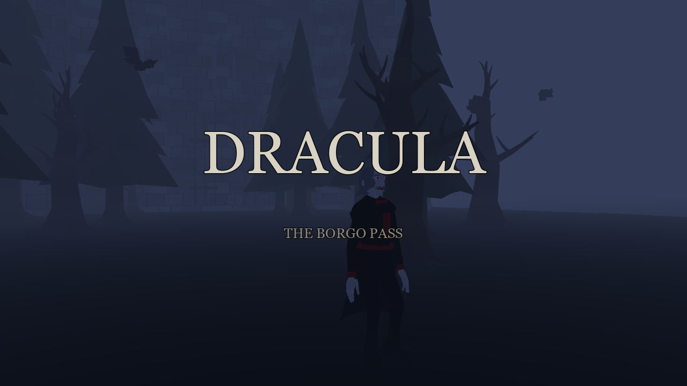
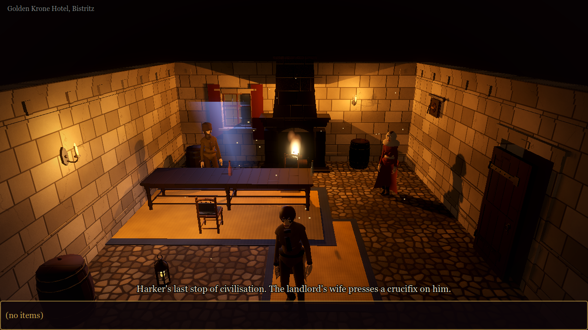
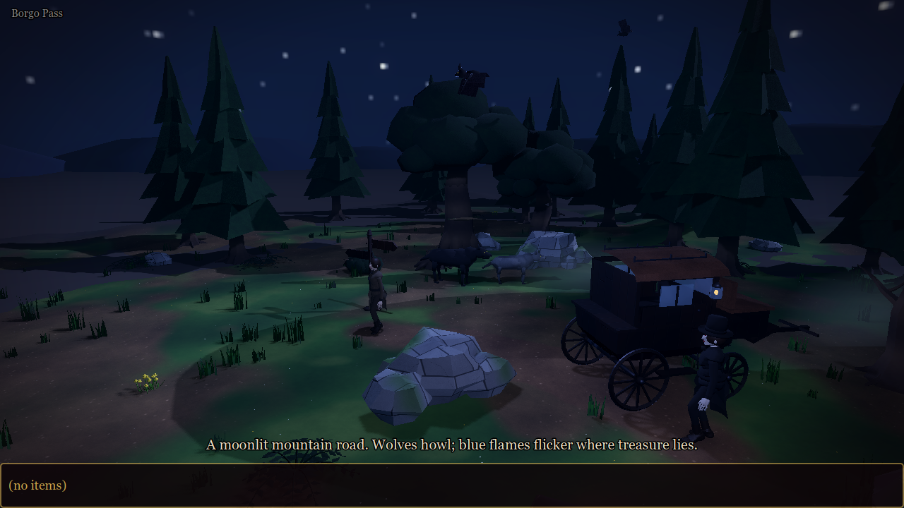
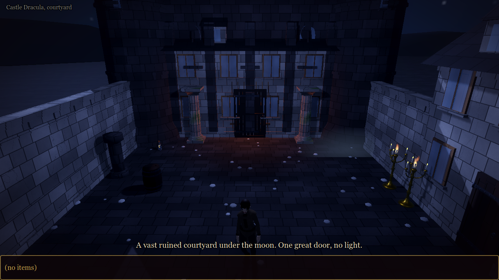
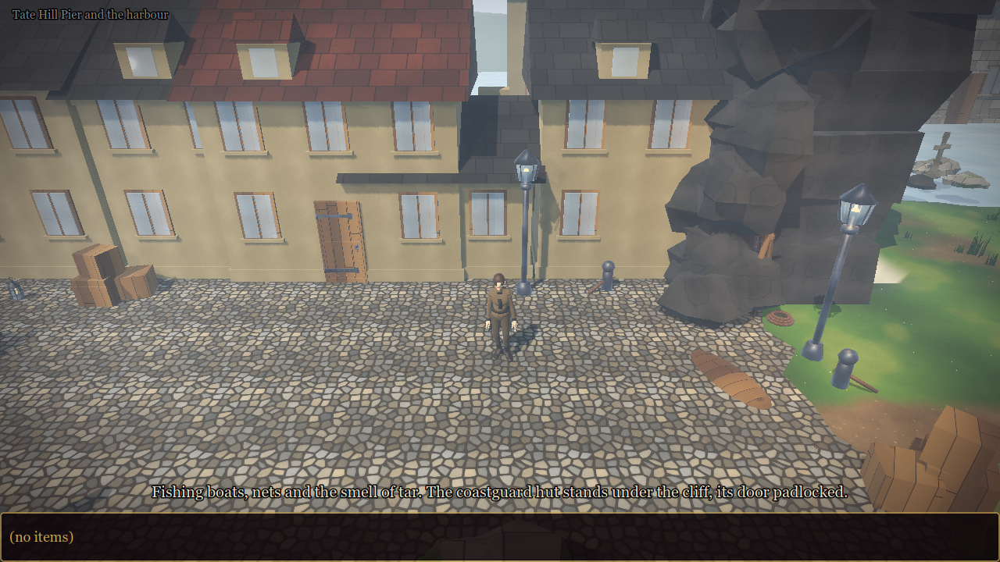
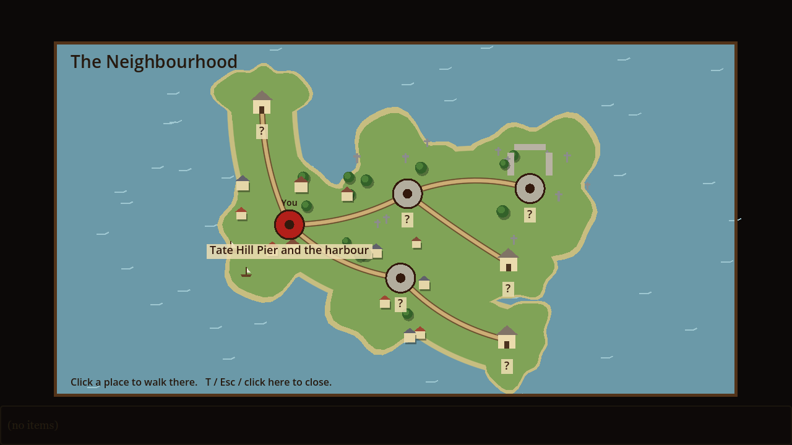
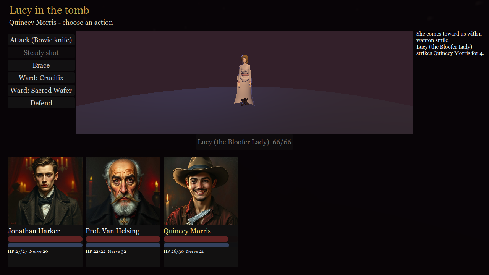
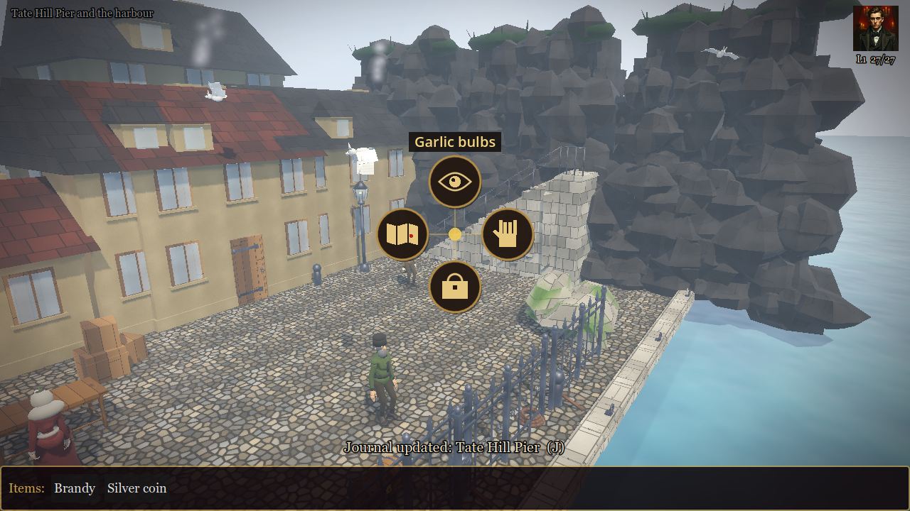

# Dracula - The Borgo Pass

3D point & click adventure (Godot 4.7) after Bram Stoker's *Dracula*. Chapters I-VI: Harker's journey, Whitby, Hillingham, Kingstead, Purfleet/Carfax and the chase back to Transylvania,
with optional generated side areas (crypts, cellars, a ruined castle), an overworld/travel map, merged outdoor regions and
an optional real-time action mode.

Everything visual is generated from the book by the pipeline below - no hand-made assets.

| | |
|---|---|
|  |  |
|  |  |
|  |  |

## Play
    ~/Programi/godot4/Godot_v4.7.1-stable_linux.x86_64 --path .

Left click on an object opens a Full Throttle style verb ring (Look, Take, Use, Use item, Talk, Go, Attack, Map outdoors); the ring can be turned off in the Esc menu, then left click acts directly. Right click: look. The item bar is sorted and colour coded (red weapons and ammunition, gold holy wards, green medicine, orange crafting material and tools, blue keys, lilac documents, teal clothing, grey other; hover shows the group) and scrolls sideways with the mouse wheel. Click an inventory item to select it,
then click something to use it (right click an item to examine it). Right click with an item selected deselects.

## Pipeline  (`python3 pipeline/build_assets.py [--force] [--only id ...]`)
| step | file | output |
|---|---|---|
| world definition | `pipeline/bible_src.py` | `pipeline/world_bible.json` - 70 assets, texture variants, 8 locations, items, dialogue |
| book scan | `pipeline/extract_book.py` | `book/chapters/*.txt`, `book/entity_index.json` (how often / where every place, character, prop appears + quotes) |
| textures | `pipeline/texture_gen.py` | `assets/textures/*` - 25 seamless procedural albedo+normal sets |
| models | `pipeline/blender_gen.py` (headless Blender) | `assets/models/*.glb`, editable `assets/blend/*.blend` |
| manifest | `pipeline/build_assets.py` | `data/manifest.json`, `data/world.json` (read by the game) |

Models are built from code with material **roles** (stone, wood, skin, top, hair ...). The game resolves each role to
a texture + tint per *variant*, so one mesh serves many looks (3 Draculas, 3 brides, 4 wood types, 10 wall/floor
materials from one wall mesh ...). Add a variant in `bible_src.py`, rebuild, no Blender work needed.
Procedural characters are separate limb nodes animated in code. Optional skinned characters (see Mixamo below) replace them when their files are present.

Add a new model: write a `b_<name>` builder in `blender_gen.py`, add `asset(...)` + variants in `bible_src.py`, rebuild.
Add a location: add a `LOC_DATA[...]` entry (4 m grid rooms, props, NPCs, exits, dialogue). Re-import with
`godot --headless --path . --import` after building new assets.

## Tools
* Combat balance table: `godot --headless --path . -- --combattest`
* Fight test screen: `-- --loc=borgo_pass --fight=lucy_tomb --party=vanhelsing,quincey --items=crucifix,host:3,stake,hammer --shot=out.png`
* Asset gallery (browse every model, cycle variants with Up/Down): `godot --path . scenes/Gallery.tscn`
* Full playthrough test of the slice: `godot --headless --path . -- --selftest`
* Debug start: `-- --loc=great_hall --give=key,lantern --flags=knocked`; screenshot: `-- --loc=... --shot=out.png`

Game text is English (taken from / in the voice of the novel). Source epub/PDFs live one folder up.

## The full story (Acts I-VI, book ch.1-27 + closing Note)
Act I lives in `pipeline/bible_src.py`; Acts II-VI are `pipeline/acts/act_N.py` (+ `act_N_builders.py` for their 3D models).
Authoring guide: `pipeline/acts/CONTRACT.md`. Acts chain through fixed ids: a2_whitby_lodging -> a3_asylum_study -> a4_hampstead_heath
-> a5_asylum_library -> a6_varna_quay -> END. Game state is saved automatically (title screen: Continue). Keys: C crafting, J journal.
* Solvability check + plan: `python3 pipeline/validate_story.py --act N [--seed-options]`
* Real-engine playthrough of every act: `./run_replays.sh [acts]`  (plans are replayed headless in Godot; fights are auto-played)
* Same for a random seed (all seeded variation active): `./run_seed_test.sh <seed> [acts]`
Status 2026-10-20: all six acts PASS on the default world and on seeds 777 and 4242.

## Personal stories (Chronicle, key M or title screen)
Ten optional arcs, each played as one character with permanent rewards (stats, items, recipe flags). Source: `pipeline/acts/arc_<id>.py`
(guide: `pipeline/acts/CONTRACT_ARC.md`). Arcs run in an isolated game state; the Chronicle shows locked/available/completed.
* In the story (unlock when the book introduces them): harker_road (after Act I), mina_records, seward_asylum, quincey_hunt, arthur_burden, vanhelsing_lore
* By your choices: renfield_mercy (revive Renfield in Act V), lucy_summer (lay Lucy to rest with Arthur in Act IV)
* After the credits (persistent across games): dracula_voivode "Seven Hundred Years", demeter_voyage "The Last Voyage"
Tests: `./run_arc_replays.sh [ids]` (real engine), `godot --headless --path . -- --arcflow` (unlock/isolation/reward rules).
Status 2026-10-20: all 10 arcs + all 6 acts PASS.

## Screens and sound (2026-10-20)
* **Party screen (P)**: portraits, level/XP, effective stats, equipment (weapon / armor / charm), skills. XP comes from fights and journal entries
  (levels 1-10: more HP/Nerve, accuracy, evasion, faith, damage). Gear comes from arc rewards and loot; keepsakes work as charms.
* **Menu (Esc)**: volume sliders (master / music / ambience / effects, saved), shortcuts to Party, Chronicle, Journal, Crafting, Quit.
* **Sound** is generated by `pipeline/audio_gen.py` (numpy/scipy -> ogg): 10 ambience loops, 5 music tracks, 22 effects. `scripts/audio.gd`
  picks ambience + music per location from its id and lighting (override with `ambience=` / `music=` in a location), crossfades, plays
  footsteps, pickups, doors, combat hits, wards, level-ups. Combat has its own track.
* Tests: `-- --audiocheck` (every location maps to loadable streams), `-- --arcflow` (arcs, levels, equipment).

## Visual pass (2026-10-20)
* **Characters** (`pipeline/chars_v2.py`): jointed humans (hips > torso > head, shoulder > elbow, hip > knee) with faces, hands, boots, coats with
  tails/lapels/buttons, dresses and gowns with hems/trains, capes with standing collars, hats (top, bowler, wide, fur, cap, shawl, bonnet);
  wolf with two-joint legs, tail and jaw; bat with two-segment wings. Overrides the old builders.
* **Animation** (`scripts/actor.gd`, procedural): walk cycle (hip sway, knee/elbow bend, counter-rotating torso, footsteps), idle (breathing,
  weight shift, looking around), talking gestures (the NPC whose name matches the dialogue speaker faces the player and gestures),
  one-shots: reach (pickups), attack, hurt (red flash), cast, victory, bow, die; wolf trot/howl; bat flap. Combat plays them from `Combat.events`.
  Gallery: `godot --path . scenes/Gallery.tscn -- --model=human_dracula --walk` (keys W walk, T talk, 1-6 one-shots).
* **Props and architecture** (`pipeline/props_v2.py`): trimmed walls (plinth, dado, cornice, framed doors/windows), fluted columns, panelled doors,
  furniture, coffins (six-sided), tombs/gravestones, trees, rocks, carriage, fireplace, keep with buttresses...
* **Atmosphere** (`scripts/location.gd`): panoramic skies (`pipeline/sky_gen.py`: night with stars/moon, dusk, day, storm, snow), a huge ground plane
  (no visible edges), rain/snow/dust/mist particles, flame particles on candles/lanterns/fireplaces, slow camera drift, vignette shader, serif UI font,
  glow/contrast grading. Quality setting in the Esc menu (Low / Medium / High: High adds SSAO and antialiasing).

## Set dressing (2026-10-21)
`scripts/dressing.gd` (+ `pipeline/decal_gen.py` textures) adds paintings/banners, curtains, wall sconces with real light, moon/sun spots with light
shafts through windows, rugs, stains, cobwebs, contact shadows and themed clutter (tavern, study, church, asylum, hall, dock, street, wild) to every
location automatically; opt out per location with `dress=False`. Lights/shadows scale with the Quality setting.
Also fixed: assets whose only variant was called "default" lost their colours (name collision in the manifest).

## Exterior pass (2026-10-21)
Town/harbour exteriors get real buildings along the north edge (`house_front_*`, windows, dormers, chimneys, smoke) instead of a bare wall, plus
new assets (`pipeline/props_v3.py`: houses, cottage, lighthouse, mast_cluster, pier, boat, lamp_post, crate_stack, bollard, rope_coil, gull),
a distant backdrop (hill ring, town skyline, ship masts, lighthouse), lamp posts that really light, gulls over water and bats at night.

## Camera zones (2026-10-21)
Wide scenes (>= 3 cells) automatically get diagonal left/right camera angles: when the character walks into that part of the scene the camera cuts
(short dark flash). Key **V** cycles views manually (auto -> main -> left -> right). Authors can add their own `cameras=[...]` zones per location
(see pipeline/acts/CONTRACT.md); a camera placed outside a walled room hides the wall in front of it (walls on the "south" side are supported).
Debug: `-- --loc=a2_harbour --at=-6.5,1 --shot=out.png` puts the character at x,z first.

## Generated dungeons (from Game Level Architect, 2026-10-21)
A level made in the Blender add-on "Game Level Architect" (v0.33+) becomes a playable location.
1. In Architect make a SINGLE-floor level (Height = 1), generate Blueprint, Walls, Doors, Props, then Export tab -> **Export Game Package (glb + json)**.
2. `python3 pipeline/import_dungeon.py /path/level.glb crypt` copies `level.glb`/`level.json` to `assets/dungeons/dungeon_crypt.glb` and
   `data/dungeons/dungeon_crypt.json` (optionally `--ambient "#5a463c,0.9,#0b0707"`) and runs `godot --headless --import`.
3. Play it: `godot --path . -- --loc=dungeon_crypt` (any location id starting with `dungeon_` is a dungeon). A sample, `dungeon_crypt`, is included.
How it works (`scripts/dungeon.gd`, `Location.build_dungeon`): the glb is the look; the json's walk rectangles are the movement (A* over the tiles, straightened);
torches become real flickering lights; walls above head height between camera and player are cut away by `shaders/cutaway.gdshader`; Architect's flat
colour swatches are restyled to this game's cobble/planks/stone while brick rings and towers keep their own textures.
Test: `godot --headless --path . -- --loc=dungeon_crypt --dungeontest` walks entrance -> exit -> every room centre (PASS on seeds 11, 21, 33, 45).
Godot may extract the glb's textures as PNGs next to it (`assets/dungeons/dungeon_*_*.png`); that is normal.
Castles: Architect's Castle tab -> **Export Castle Package**, then `python3 pipeline/import_dungeon.py castle.glb castle --sky night` (outdoor: sky, moon, a camera further back); sample `dungeon_castle`.
Story hooks (no change to world.json, so the story validator is untouched): `--from chapel_crypt:4.6,-1.0 --from-name "Narrow stair down"` adds a door to that location at runtime
(`Dungeon.inject`); walking back onto the dungeon's entrance tile returns there; `--exit-to <location>` makes the level's exit tile lead on. `dungeon_crypt` is wired to `chapel_crypt` this way.
Tests: `--loc=chapel_crypt --dungeonlinktest` (down and back), `--loc=dungeon_castle --dungeontest`; all act/arc replays still pass.
Props: the package's `props` list replaces Architect's baked decoration with this game's own models (crate_stack, column, coffin, tomb, table, chair, bed, bookshelf, chest, barrel, candelabra; `Dungeon.PROP_MAP`), big ones block movement.
Not done yet: several floors, doors that open, a story reason for the generated places, tower floors / castle keep interiors.

### Story: the catacombs below the chapel (optional, Act I)
After Harker takes the Count's keys in `chapel_crypt`, a low iron door in the east wall (locked without `vault_key`) leads down into the generated `dungeon_crypt`:
a journal entry on arrival (`a1_j_cat`), a tomb ("a name begins with a D"), an open coffin prised up from inside, a tarnished silver crucifix to take (gives `silver`, a crafting
ingredient), candle stumps, and at the far end a heap of gold (ch. III: Roman, British, Austrian, Hungarian, Greek and Turkish coin, none under three hundred years old; journal `a1_j_gold`, +25 xp, once).
Walking back onto the entrance tile returns to the chapel; the main stair to the vault (the Act I exit) is untouched, and world.json / the story validator only gained the two journal entries.
How it is authored: `data/dungeons/<id>.story.json` (never overwritten by an import) with `entrance` overrides, `on_enter`, and `props` placed by anchors (`entrance`, `exit`, `room:K`, `far:K`) so a re-generated
level keeps the story. Props use the normal `interact` keys; new: `do` = one-time scripted reaction (any `Game.run` actions: say/journal/xp/give/set...), afterwards the prop only describes itself.
Test: `godot --headless --path . -- --loc=chapel_crypt --dungeonstorytest` (locked without keys, goes down with them, journal, silver, gold once only); `--dungeontest` also walks up to every story prop.

### Story, part 2 (2026-10-21)
* **Catacombs, a puzzle:** the rusted iron door at the far end now yields to the hammer (the one Harker needed for the chapel gate): journal `a1_j_cliff`, +15 xp -
  beyond it a ledge, the gorge and the castle's south wall with Harker's own window. Without the hammer it only says it must be struck.
* **Act VI, "the outer ward":** from `a6_castle_gate` a *breach in the curtain wall* leads into `dungeon_castle_ruin`, a ruined generated castle (Architect Castle, Ruin 0.55) in snow light.
  Journal `a6_j_ward` on arrival; props: a fallen merlon, a splintered beam (take: `wood`, for stakes), the keep door (rotted), the Count's broken calèche, a Szgany cartridge pouch
  (take: `bullet`), a cracked looking-glass (Van Helsing is glad of his reflection), and a cold campfire (+20 xp, "a fire not two days old"). Always open; nothing in it is required for the story.
  Import: `python3 pipeline/import_dungeon.py castle_ruin.glb castle_ruin --from a6_castle_gate:-1.6,3.3 --sky snow --no-lights --no-moon --ambient "#7a8aa0,1.3,#a8b4c0"`.
* Castle packages carry four named areas (COURTYARD, KEEP_FRONT, WEST_YARD, EAST_YARD) usable as `room:0..3` anchors in a `.story.json`.
* Tests: `--loc=a6_castle_gate --ruinstorytest`, `--loc=chapel_crypt --dungeonstorytest` (now with the hammer door), `--loc=dungeon_castle_ruin --dungeontest` (walks to every area and up to every prop).
  Lesson: a prop that belongs to a wall must have radius <= 0.25 (no movement blocker) and be pushed into the wall, or it can block the only route.

### Doors, floors, and Carfax (2026-10-21)
* **Doors open.** Architect's door panels (each its own node, origin = hinge) swing 90 degrees away from the player when he comes within 2.3 m of the doorway's middle and shut again beyond 3.4 m
  (`Dungeon._swing_doors`, sound `door`). Test: `--dungeondoortest`.
* **Floors.** A multi-floor Architect level becomes one location per floor: Architect *Export Package per Floor* writes `<name>_f0/_f1...`; `python3 pipeline/import_dungeon.py cellar_f0.glb carfax_cellar --from ...`
  imports all siblings as `dungeon_carfax_cellar_f0`, `..._f1`, wires the stair triggers (`stairs_out`) and arrival points (`arrivals`). Walking onto a stair cell fades to the other floor and back; floor_y shifts upper floors to y = 0.
  Test: `--loc=dungeon_carfax_cellar_f0 --stairtest`.
* **Act V, the cellars below the Carfax chapel (optional, 2 floors).** A cellar stair beside the nave wall of `a5_carfax_chapel` (refuses while the rats live: `won:carfax_rats`). Floor 0: journal `a5_j_cellar`
  (fifty boxes came, twenty-nine stand above), a jar of lamp oil (`oil`), torn shipping labels (journal `a5_j_labels`, +20 xp: "Carter, Paterson", "Jamaica L...", "Piccad..."), empty wine racks, straw packing with drag-marks.
  Floor 1: journal `a5_j_vault`, a split earth-box, tarred rope (`rope`), a brick-lined well shaft (+25 xp). Stories in `dungeon_carfax_cellar_f0/f1.story.json`.
  Test: `--loc=a5_carfax_chapel --cellartest`. All acts, arcs, selftest and the earlier dungeon tests still pass.

### Side areas for Acts II-IV (2026-10-21)
All optional, generated with Architect, entered through a door injected into an existing location (no change to world.json beyond journal entries), left by walking back onto the entrance tile.
* **Act II, Whitby Abbey -> `dungeon_abbey_undercroft`** (sunken steps behind the founder's slab; Mina's journal `a2_j_undercroft`): sexton's lantern, a monk's grave moved by an inch, a rag of white lawn (Lucy's; +20 xp),
  an abbey reliquary (take `host`), sleeping bats, a bricked-up arch scratched from the other side.
* **Act III, Seward's asylum ward -> `dungeon_asylum_cellar`** (cellar stair; Seward's diary `a3_j_cellar`): restraint cot, the old case-books (`a3_j_casebook`, +20 xp: "he spoke of a Master then also"),
  dispensary stock (take `chloral`), a cell scratched with "HE IS COMING" in a hundred hands, none Renfield's.
* **Act IV, Kingstead churchyard -> `dungeon_kingstead_catacombs_f0/_f1`** (two floors, the shifted slab of the railed tomb; Van Helsing's notes `a4_j_catacombs`, `a4_j_lower`): a lead coffin, an iron crucifix (take `crucifix`),
  and on the lower floor a coffin prised open from within, an old stake (take `stake`) and a sealed ossuary door that scratches back.
Each has a `data/dungeons/<id>.story.json`. Tests: `--loc=<origin> --sidetest=<door>|<journal>|<prop>|<item>` (goes down, journal, prop reward, walks away and back) - PASS for all three;
`--dungeontest` on all four levels and `--stairtest` on the catacombs also pass, as do all acts/arcs, selftest and the earlier story tests.
Import recipes: `python3 pipeline/import_dungeon.py abbey.glb abbey_undercroft --from a2_abbey_ruins:-1.8,3.4 --from-name "Sunken steps" --ambient "#3c4452,0.8,#07090c"` (likewise `asylum_cellar` from `a3_asylum_ward:0.9,3.0`,
`kingstead_catacombs` from `a4_kingstead_churchyard:4.2,-5.8` using the `_f0` file).

The game opens with a short title sequence (quotes from the novel over a moonlit approach to the castle); click, Space, Enter or Esc skips it. `--nointro` disables it.

## Download
Linux AppImage on the Releases page: `chmod +x Dracula-*.AppImage && ./Dracula-*.AppImage` (includes the Mixamo characters).

## Mixamo characters (optional, not in the repository)
`pipeline/mixamo/` holds the tooling for skinned characters: `dress.py` dresses Mixamo's X Bot / Y Bot as each procedural human
(parameters in `humans.json`, colours come from the model variants), `export_mixamo.py lib` builds the shared animation
library from your own Mixamo downloads (`clips.json` maps game names to clips, `fingerprint.py` removes duplicate clips),
`build_costumes.sh` builds every character. Skirts, coat tails and capes are cloth driven by a SpringBoneSimulator3D.
The Mixamo files themselves (FBX, `assets/anims/mixamo_lib.glb`, `assets/models/chars/`) are git-ignored because Adobe's
terms do not allow redistributing them outside a game; without them the game uses the procedural characters. Design
notes: `docs/DESIGN.md`.

## Licence
Code: MIT (see LICENSE). Story and character names come from Bram Stoker's *Dracula* (public domain). Generated textures,
models, audio and portraits were produced by the pipeline in this repository. Mixamo content in release builds is used
under Adobe's Mixamo terms.
